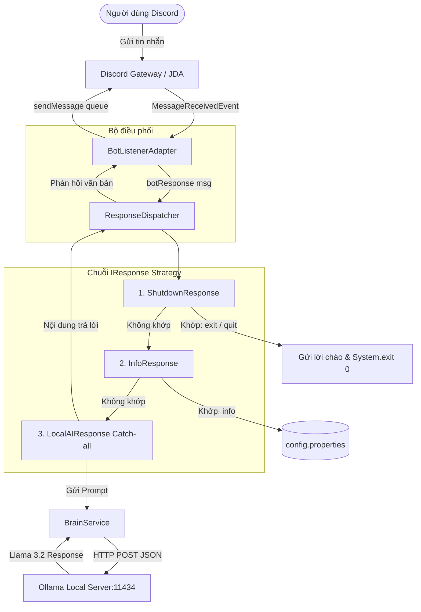

# 🗡️ AlphaBot - Discord Bot Tích Hợp Local AI (Ollama)

Dự án Bot Discord thông minh viết bằng **Java 21** kết hợp thư viện **JDA (Java Discord API)** và **Local LLM (Ollama - Llama 3.2)**, được thiết kế theo phong cách nhân vật **Lucia / Alpha** (từ *Punishing: Gray Raven*).

---

## 📌 Mục lục
- [1. Giới thiệu tổng quan](#1-giới-thiệu-tổng-quan)
- [2. Tính năng chính](#2-tính-năng-chính)
- [3. Kiến trúc dự án & Design Patterns](#3-kiến-trúc-dự-án--design-patterns)
- [4. Cấu trúc thư mục](#4-cấu-trúc-thư-mục)
- [5. Yêu cầu hệ thống](#5-yêu-cầu-hệ-thống)
- [6. Hướng dẫn cài đặt và khởi chạy](#6-hướng-dẫn-cài-đặt-và-khởi-chạy)
- [7. Cấu hình hệ thống](#7-cấu-hình-hệ-thống)
- [8. Danh sách lệnh & Tương tác](#8-danh-sách-lệnh--tương-tác)
- [9. Chi tiết các module mã nguồn](#9-chi-tiết-các-module-mã-nguồn)
- [10. Đánh giá & Đề xuất cải tiến](#10-đánh-giá--đề-xuất-cải-tiến)

---

## 1. Giới thiệu tổng quan

**AlphaBot** là một bot Discord tự lưu trữ (self-hosted) kết hợp trí tuệ nhân tạo chạy cục bộ trên máy tính. Dự án giải quyết bài toán:
- Tương tác với người dùng theo thời gian thực trên các kênh Discord (Server và Direct Message).
- Bảo vệ quyền riêng tư và tiết kiệm chi phí API bên ngoài bằng cách sử dụng **Ollama** chạy mô hình mã nguồn mở **Llama 3.2 (3B)**.
- Xây dựng nhân cách số (Persona) cho bot: **Lucia** – cận vệ trung thành, phong thái lạnh lùng, dứt khoát nhưng tôn trọng Chỉ huy.

---

## 2. Tính năng chính

- 🤖 **Tích hợp Discord JDA v5**: Lắng nghe và phản hồi tin nhắn trong server hoặc tin nhắn trực tiếp với đầy đủ Gateway Intents (`GUILD_MESSAGES`, `MESSAGE_CONTENT`, `DIRECT_MESSAGES`).
- 🧠 **Local LLM Brain (Ollama)**: Kết nối HTTP API nội bộ tới `http://localhost:11434/api/generate`, tương tác với mô hình `llama3.2` mà không phụ thuộc vào internet hay dịch vụ tính phí.
- ⚙️ **Kiến trúc chuỗi xử lý mở rộng (Chain of Responsibility & Strategy)**: Các hành vi phản hồi (`IResponse`) được tách biệt thành từng class riêng biệt, dễ dàng thêm mới tính năng mà không ảnh hưởng code cũ.
- 🛑 **Quản lý vòng đời (Lifecycle Management)**: Hỗ trợ lệnh tắt hệ thống từ xa (`exit` / `quit`), tự giải phóng tài nguyên JDA và tiến trình Java.
- 🔒 **Bảo mật cấu hình**: Tách biệt token và các thông tin nhạy cảm qua file `.env`.

---

## 3. Kiến trúc dự án & Design Patterns

### Sơ đồ kiến trúc & luồng dữ liệu



### Các mẫu thiết kế (Design Patterns) áp dụng:
1. **Chain of Responsibility & Strategy Pattern (`IResponse`, `ResponseDispatcher`)**:
   - `ResponseDispatcher` duy trì danh sách các handler `IResponse`.
   - Mỗi tin nhắn đi qua chuỗi handler; handler nào trả về `canHandle(message) == true` sẽ nhận quyền `execute(message)`.
2. **Adapter Pattern (`BotListenerAdapter`)**:
   - Mở rộng từ `ListenerAdapter` của JDA để chuyển đổi các sự kiện từ Discord thành các lời gọi xử lý nghiệp vụ nội bộ của bot.
3. **Service Layer (`BrainService`, `Info_Bot`, `Answers`)**:
   - Tách biệt tầng logic gọi AI và tầng đọc tài nguyên khỏi tầng điều khiển Discord.

---

## 4. Cấu trúc thư mục

```
alphabot/
├── .env                       # File cấu hình biến môi trường (chứa BOT_TOKEN)
├── .env.example               # Mẫu tham chiếu biến môi trường
├── pom.xml                    # Cấu hình dự án Maven & Dependencies
├── src/
│   ├── main/
│   │   ├── java/
│   │   │   ├── start_bot/
│   │   │   │   └── Debug.java                  # Main entry point khởi chạy bot
│   │   │   ├── control_center/
│   │   │   │   ├── BotController.java          # Cấu hình JDA, Intents và khởi động bot
│   │   │   │   ├── BotListenerAdapter.java     # Lắng nghe sự kiện tin nhắn từ Discord
│   │   │   │   ├── ResponseDispatcher.java     # Điều phối luồng xử lý tin nhắn
│   │   │   │   └── response/
│   │   │   │       └── IResponse.java          # Interface chuẩn cho các loại phản hồi
│   │   │   └── bot/
│   │   │       ├── AlphaBot.java               # Thực thể đại diện Bot và nạp cấu hình
│   │   │       ├── bot_response/
│   │   │       │   ├── InfoResponse.java       # Phản hồi thông tin hệ thống ('info')
│   │   │       │   ├── ShutdownResponse.java   # Phản hồi yêu cầu tắt bot ('exit' / 'quit')
│   │   │       │   └── LocalAIResponse.java    # Phản hồi thông qua Local LLM
│   │   │       └── botbrain/
│   │   │           ├── BrainService.java       # Service giao tiếp HTTP với Ollama
│   │   │           └── static_answer/
│   │   │               ├── Info_Bot.java       # Đọc thuộc tính từ config.properties
│   │   │               └── Answers.java        # Bộ nạp dữ liệu từ answers.txt
│   │   └── resources/
│   │       ├── config.properties               # Cấu hình tên và frame bot
│   │       └── answers.txt                     # Danh sách câu trả lời mẫu dạng key|value
│   └── test/                                   # Thư mục chứa Unit/Integration tests
```

---

## 5. Yêu cầu hệ thống

- **Java Development Kit (JDK)**: Phiên bản **21** trở lên.
- **Apache Maven**: Phiên bản **3.8+**.
- **Ollama**: Đã cài đặt và đang chạy dịch vụ tại `http://localhost:11434`.
  - Mô hình yêu cầu: `llama3.2` (hoặc cấu hình lại tên model trong `BrainService.java`).
- **Tài khoản Discord & Bot Application**: Tạo ứng dụng trên [Discord Developer Portal](https://discord.com/developers/applications).
  - Bật các Privileged Gateway Intents: **Message Content Intent**.

---

## 6. Hướng dẫn cài đặt và khởi chạy

### Bước 1: Chuẩn bị Ollama AI
Khởi động Ollama và kéo model `llama3.2`:
```bash
# Cài đặt hoặc khởi chạy dịch vụ Ollama
ollama serve

# Tải model (chỉ cần chạy lần đầu)
ollama run llama3.2
```

### Bước 2: Thiết lập biến môi trường
Tạo file `.env` tại thư mục gốc của dự án (tham khảo `.env.example`):
```env
BOT_TOKEN=YOUR_DISCORD_BOT_TOKEN_HERE
PERMISSION=8
```

### Bước 3: Biên dịch dự án
Đảm bảo biến môi trường `JAVA_HOME` đang trỏ tới JDK 21:
```bash
# Thiết lập JAVA_HOME (nếu máy có nhiều phiên bản JDK)
export JAVA_HOME=/usr/lib/jvm/java-21-openjdk

# Kiểm tra phiên bản Java của Maven
mvn -version

# Biên dịch dự án
mvn clean compile
```

### Bước 4: Khởi chạy Bot
Chạy bot trực tiếp thông qua plugin `exec-maven-plugin`:
```bash
JAVA_HOME=/usr/lib/jvm/java-21-openjdk mvn exec:java
```
Khi khởi động thành công, màn hình console sẽ hiển thị:
```text
[ Hệ thống ]: Discord Bot đang khởi động và kết nối...
```

---

## 7. Cấu hình hệ thống

### 7.1. Cấu hình định danh (`src/main/resources/config.properties`)
```properties
BOT_NAME=Alpha
BOT_FRAME_1=Crimson Abyss
BOT_FRAME_2=Crimson Weave
BOT_FRAME_3=Inverse Crown
```

### 7.2. Dữ liệu câu trả lời tĩnh (`src/main/resources/answers.txt`)
Dữ liệu được lưu dưới dạng `từ khóa|câu trả lời`:
```text
hello|Xin chào, Chỉ huy. Ngài cần em hỗ trợ gì?
status|Hệ thống đang hoạt động ở mức năng lượng tối ưu.
who are you|Em là Lucia. Thanh kiếm của ngài.
```

---

## 8. Danh sách lệnh & Tương tác

| Cú pháp tin nhắn | Handler xử lý | Hành vi / Kết quả |
| :--- | :--- | :--- |
| `info` (không phân biệt hoa thường) | `InfoResponse` | Trả về: `Tên: Alpha \| Khung: Crimson Abyss` |
| `exit` hoặc `quit` | `ShutdownResponse` & `BotListenerAdapter` | Trả lời: *"Đang ngắt kết nối. Tạm biệt Chỉ huy."* và dừng ứng dụng bot |
| Mọi câu hỏi / tin nhắn khác | `LocalAIResponse` | Gửi câu hỏi vào lõi AI `BrainService` (Ollama Llama 3.2), trả lời với phong thái Lucia |

---

## 9. Chi tiết các module mã nguồn

### 9.1. Gói `control_center`
- **`BotController`**: Quản lý vòng đời JDA. Lấy token từ `AlphaBot`, cấu hình các intents `GUILD_MESSAGES`, `MESSAGE_CONTENT`, `DIRECT_MESSAGES`, đăng ký listener `BotListenerAdapter` và kích hoạt bot.
- **`BotListenerAdapter`**: Kế thừa `ListenerAdapter`. Lọc bỏ các tin nhắn sinh ra bởi chính bot (`isBot()`). Chuyển nội dung sang `ResponseDispatcher` và thực hiện gửi trả kết quả hoặc xử lý sự kiện ngắt kết nối.
- **`ResponseDispatcher`**: Khởi tạo danh sách các `IResponse` theo thứ tự ưu tiên:
  1. `ShutdownResponse`
  2. `InfoResponse`
  3. `LocalAIResponse` (Fallback cuối cùng)
- **`IResponse` (Interface)**:
  - `boolean canHandle(String message)`: Kiểm tra tin nhắn có thuộc quyền xử lý của handler không.
  - `String execute(String message)`: Thực thi sinh chuỗi phản hồi.

### 9.2. Gói `bot` và `bot_response`
- **`AlphaBot`**: Lớp điều phối trung tâm của Bot. Đọc cấu hình môi trường `.env` qua thư viện `dotenv-java`.
- **`ShutdownResponse`**: Kiểm tra từ khóa thoát. Trả về mã cờ `[SYSTEM_SHUTDOWN]` cho `BotListenerAdapter` bắt sự kiện.
- **`InfoResponse`**: Đọc các thuộc tính định danh từ `Info_Bot` để phản hồi người dùng.
- **`LocalAIResponse`**: Đóng vai trò là handler mặc định (luôn trả về `true` ở `canHandle`), ủy quyền cho `BrainService`.

### 9.3. Gói `botbrain`
- **`BrainService`**: 
  - Khởi tạo `java.net.http.HttpClient`.
  - Đóng gói System Prompt: *"Bạn là Lucia, người bảo vệ của Chỉ huy Hoàng. Hãy trả lời ngắn gọn, lạnh lùng nhưng tôn trọng."* kèm câu hỏi của người dùng.
  - Gửi POST request tới Ollama Endpoint (`/api/generate`) với payload `stream: false`.
  - Phân tích chuỗi phản hồi thô (raw JSON parsing) và xử lý ký tự escape.
- **`Info_Bot`**: Nạp và trích xuất dữ liệu từ `config.properties` trong classpath.
- **`Answers`**: Nạp từ điển các câu hỏi - đáp nhanh từ `answers.txt`.

---

## 10. Đánh giá & Đề xuất cải tiến

1. **Xử lý bất đồng bộ (Non-blocking I/O)**:
   - Hiện tại phương thức `BrainService.think(...)` là đồng bộ (blocking HTTP call). Với LLM sinh câu trả lời trong vài giây, điều này có thể chiếm giữ thread của JDA.
   - *Khuyến nghị*: Dùng `client.sendAsync(...)` hoặc chạy trong một `ExecutorService` / `CompletableFuture`, kèm hiển thị trạng thái đang soạn tin nhắn (`channel.sendTyping().queue()`).

2. **Parser JSON an toàn**:
   - Hiện tại hàm `extractResponse` cắt chuỗi bằng `indexOf("\"response\":\"")`. Nếu câu trả lời từ AI chứa định dạng JSON phức tạp hoặc ký tự đặc biệt lồng nhau, chuỗi có thể bị cắt sai.
   - *Khuyến nghị*: Tích hợp thư viện JSON tiêu chuẩn như Jackson (`jackson-databind`) hoặc Gson.

3. **Tích hợp `Answers.java` vào chuỗi phản hồi**:
   - Class `Answers` đã được viết hoàn chỉnh nhưng chưa được đưa vào `ResponseDispatcher`. Có thể tạo thêm `StaticAnswerResponse` đặt trước `LocalAIResponse` để bot trả lời ngay lập tức các câu chào hỏi thường gặp mà không cần đánh thức mô hình AI.

4. **Sửa lỗi logic kiểm tra Token**:
   - Trong `AlphaBot.java`, khi lỗi trả về `"[SYSTEM-ERROR]: Không tìm thấy bot token."`. Nhưng trong `BotController.java` lại so sánh `token.equals("[SYSTEM-ERROR]")`. Cần sửa thành `token.startsWith("[SYSTEM-ERROR]")` hoặc kiểm tra `null` để tránh lỗi ngoại lệ khi chưa cấu hình token.
